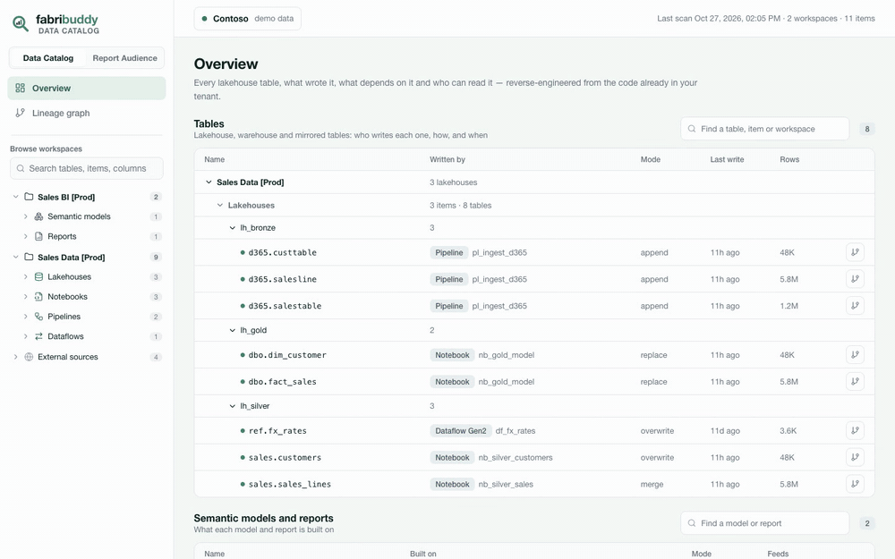
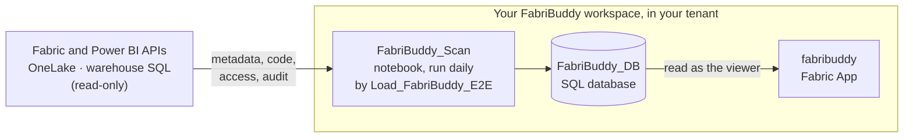

  

  <b>Data lineage for Microsoft Fabric, reverse-engineered from your code.</b> 
  Where every table comes from, the exact lines that write it, and who can see every Power BI report. 
  Free and open source. A Fabric App that runs in your own tenant.

  <a href="https://zan-tavcar.github.io/msfabric-fabribuddy/demo/"><b>Live demo</b></a> ·
  <a href="https://zan-tavcar.github.io/msfabric-fabribuddy/"><b>Documentation</b></a> ·
  <a href="https://zan-tavcar.github.io/msfabric-fabribuddy/deploy/">Deploy</a> ·
  <a href="https://zan-tavcar.github.io/msfabric-fabribuddy/data-stays-in-your-tenant/">Your data stays in your tenant</a>

---

> [!IMPORTANT]
> **Your data never leaves your tenant.** FabriBuddy is a Fabric App that you install in your own
> Fabric tenant. The scanner, its database and the app all run in a workspace you own, on your own
> capacity. There is no FabriBuddy server, no account, no telemetry and nothing to pay for.
> [How this works](https://zan-tavcar.github.io/msfabric-fabribuddy/data-stays-in-your-tenant/)

  
   Click a table to trace it upstream and downstream, then open the exact code that writes it.
  <a href="https://zan-tavcar.github.io/msfabric-fabribuddy/">Full-quality video on the docs site</a>.

## What you get

**Data Catalog**
- **Table lineage**, from external sources through lakehouse and warehouse tables to semantic models
  and reports, as a graph you can trace.
- **The code that writes each table**, with the exact lines highlighted: notebooks (Spark SQL and
  PySpark), pipelines, Dataflows Gen2, warehouse procedures, eventstreams, shortcuts and mirroring.
- **Who can read each table**: workspace roles, OneLake roles, and indirect access through semantic
  models.

**Report Audience**
- **Who can see each Power BI report**, person by person, with Entra groups opened up to their
  members.
- **Who opens each report**, from the audit log (the last 30 days).
- **Pro and PPU licences nobody uses.**

It reads metadata, code, access and the audit log. It never reads table rows or report data, and it
never changes anything in your tenant.

## How it works

## Deploy

About 15 minutes. You need a workspace on a Fabric capacity and a service principal.

1. Import [`scripts/Deploy_FabriBuddy.ipynb`](./scripts/Deploy_FabriBuddy.ipynb) into the workspace,
   fill in the service principal, and choose **Run all**.
2. Run the five commands its last cell prints, to add the app.
3. Open **fabribuddy** in the workspace.

[**Step-by-step guide →**](https://zan-tavcar.github.io/msfabric-fabribuddy/deploy/)

## Documentation

| | |
|---|---|
| [Your data stays in your tenant](https://zan-tavcar.github.io/msfabric-fabribuddy/data-stays-in-your-tenant/) | What runs where, what is read, every network call |
| [Deploy](https://zan-tavcar.github.io/msfabric-fabribuddy/deploy/) | First deployment, step by step |
| [Service principal](https://zan-tavcar.github.io/msfabric-fabribuddy/service-principal/) | The app registration, tenant setting and roles |
| [The app](https://zan-tavcar.github.io/msfabric-fabribuddy/app/) | Adding the Fabric App and sharing it |
| [Settings](https://zan-tavcar.github.io/msfabric-fabribuddy/settings/) | What is scanned, and when |
| [Update](https://zan-tavcar.github.io/msfabric-fabribuddy/update/) | Getting a new version |
| [Troubleshooting](https://zan-tavcar.github.io/msfabric-fabribuddy/troubleshooting/) | Common errors and their fixes |

> [!CAUTION]
> FabriBuddy is a community project, not a Microsoft product. It comes without warranty or official
> support. It runs on your Fabric capacity and uses its capacity units: try it on a non-production
> capacity first.

## License

[MIT](./LICENSE). Microsoft Fabric and Power BI are trademarks of Microsoft; FabriBuddy is
independent and not affiliated with Microsoft.
