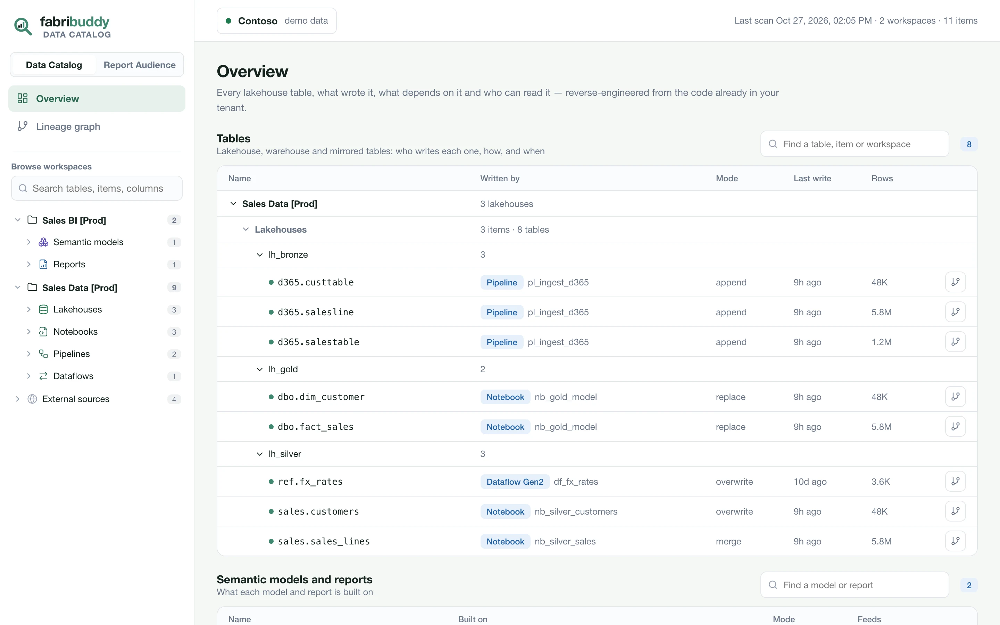
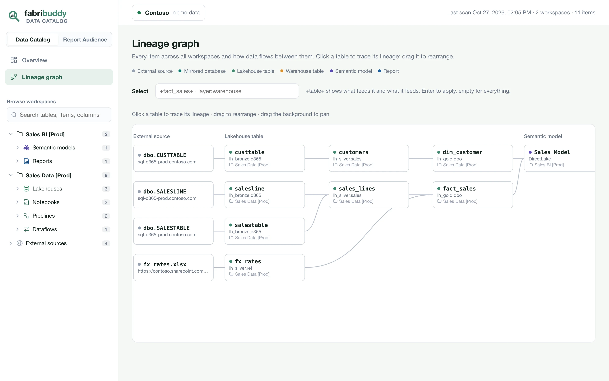
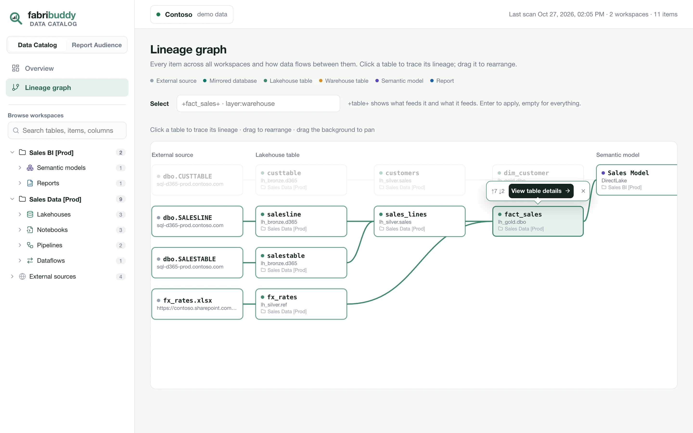
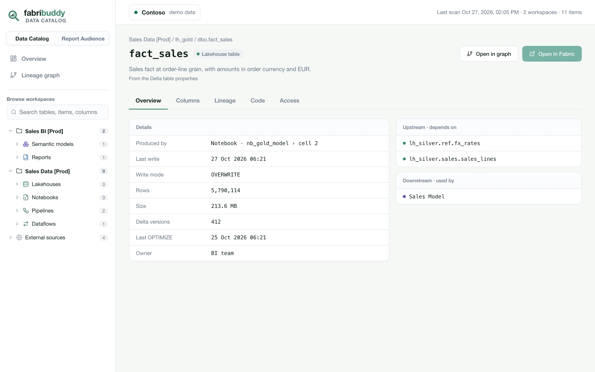
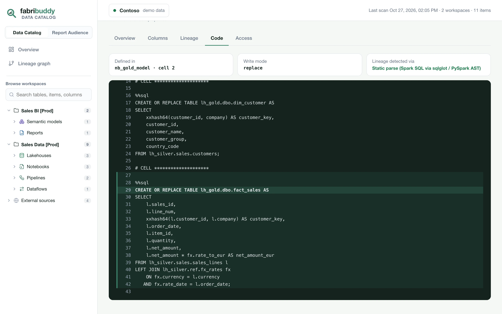
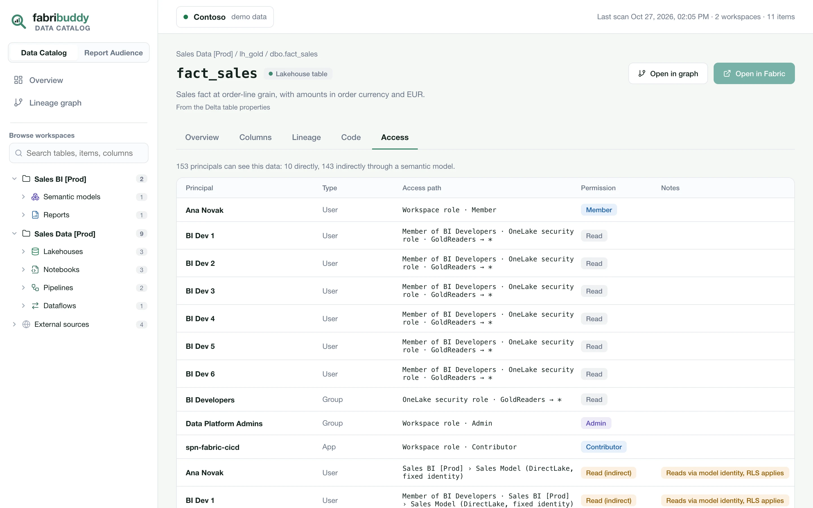

# Data Catalog

Every lakehouse and warehouse table, what writes it, what depends on it and who can read it. Built
from the code and metadata already in your tenant.

## Overview

The Data Catalog opens on its overview: two catalogs, each with its own search.

- **Tables**: every lakehouse, warehouse and mirrored table, grouped by workspace and item, with the
  item that writes it, the write mode, the last write and the row count.
- **Semantic models and reports**: what each model and report is built on, a model's storage mode,
  and how many reports use it.

Click a row to open its page, or the branch icon at the end of the row to open its lineage in the
graph. If the last scan couldn't read something, a note at the top says how many things, and
*Show what* lists each one and why.

{ .fb-shot }

## Lineage graph

The graph lays the estate out from external sources through the lakehouse and warehouse layers to
semantic models and reports. Each card names the table, its lakehouse or warehouse, and its
workspace. Click a table to light up everything upstream and downstream of it. Drag tables to
rearrange them, and drag the background to pan.

The **Select** box narrows the graph: `+fact_sales+` shows what feeds a table and what it feeds,
`layer:warehouse` shows one layer.

{ .fb-shot }

{ .fb-shot }

## Table and item pages

Open a table from the graph, the catalog, the sidebar or search. Its tabs:

| Tab | Shows |
|---|---|
| **Overview** | What produces it (the item, and the notebook cell or pipeline activity), what orchestrates it, the last write, write mode, rows, size and Delta versions, and what it depends on and what uses it. |
| **Columns** | Each column's type and description, with likely personal data tagged. |
| **Lineage** | One hop up and down. |
| **Code** | The code that writes the table, with the writing lines highlighted. |
| **Access** | Everyone who can read the data: workspace roles, OneLake data access roles, groups opened up to their members, and people who reach it indirectly through a semantic model. |

*Open in graph* shows everything that feeds the table and everything it feeds. *Open in Fabric*
opens its lakehouse or warehouse in Microsoft Fabric.

{ .fb-shot }

{ .fb-shot }

{ .fb-shot }

Items have pages too, opened from the sidebar. A lakehouse or warehouse lists its tables and what
writes them; a notebook, pipeline or dataflow shows what it reads and writes, and its code.

## Search

The sidebar lists every workspace, item and table, and each table folds out to its columns. Its
search finds tables, items and columns by name. Click a column to open its table on the *Columns*
tab.

## Personal data

Columns whose names suggest personal data (e-mail, phone, birth date…) are tagged automatically.
Each table's *Access* tab shows who can read them.

## What it reads

| Source | Read for |
|---|---|
| Notebooks (Spark SQL, PySpark), Spark job definitions | The tables each one reads and writes |
| Pipelines (Copy, Notebook, Invoke pipeline) | Copies and orchestration |
| Dataflows Gen2 (M) | Sources and destinations |
| Warehouse T-SQL and query history | Views, procedures and executed statements |
| Eventstreams, shortcuts and mirroring | Where data comes from |
| Semantic models (TMDL) and reports (PBIR) | What each is built on |
| Delta logs | Last write, rows, size, history. Commit metadata only, never data files. |

FabriBuddy never fills a gap with a guess. When the code decides a target only at run time, or a
workspace isn't scanned, the lineage stops there and the overview says so.
