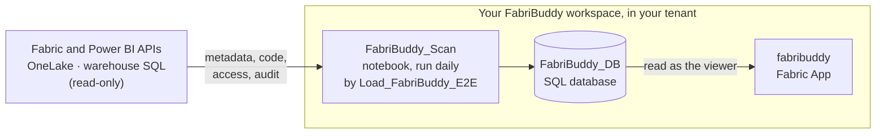

---
hide:
  - navigation
  - toc
---

<h1 class="fb-word">fabribuddy</h1>

<strong>Data lineage for Microsoft Fabric, reverse-engineered from your code.</strong>
Where every table comes from, the exact lines that write it, and who can see every Power BI report.
Shipped as a Fabric App that runs in your own tenant. Free and open source.

[Deploy FabriBuddy](deploy.md){ .md-button .md-button--primary }
[See it on GitHub](https://github.com/zan-tavcar/msfabric-fabribuddy){ .md-button }

<video class="fb-video" autoplay loop muted playsinline poster="assets/video/lineage-demo-poster.webp">
  <source src="assets/video/lineage-demo.mp4" type="video/mp4">
</video>

Click a table to trace it upstream and downstream, then open the exact code that writes it.

**Your data never leaves your tenant.**

FabriBuddy is a **Fabric App that you install in your own Fabric tenant**. The scanner, the
database and the app all run in a workspace you own, on your own capacity. There is no FabriBuddy
server, no account to create, no telemetry and nothing to pay for. Nothing FabriBuddy reads is
ever sent outside your Microsoft tenant.

[How this works →](data-stays-in-your-tenant.md)

## What you get

-   :material-graph-outline:{ .lg .middle } **Data Catalog**

    ---

    - **Table lineage**, from external sources through lakehouse and warehouse tables to semantic
      models and reports, as a graph you can trace.
    - **The code that writes each table**, with the exact lines highlighted. It reads notebooks
      (Spark SQL and PySpark), pipelines, Dataflows Gen2, warehouse procedures, eventstreams,
      shortcuts and mirroring.
    - **Who can read each table**: workspace roles, OneLake roles, and indirect access through
      semantic models.

    [Data Catalog →](data-catalog.md)

-   :material-account-eye-outline:{ .lg .middle } **Report Audience**

    ---

    - **Who can see each Power BI report**, person by person: workspace roles, direct access,
      organisation-wide links and publish to web, with Entra groups opened up to their members.
    - **Who opens each report**, from the Power BI audit log for the last 30 days.
    - **Pro and PPU licences nobody uses.**

    [Report Audience →](report-audience.md)

-   :material-shield-lock-outline:{ .lg .middle } **Read-only, metadata only**

    ---

    It reads code, metadata, access and the audit log. It never reads the rows in your tables
    or the data in your reports, and it never changes anything in your tenant.

    [What it reads →](data-stays-in-your-tenant.md#what-it-reads)

-   :material-scale-balance:{ .lg .middle } **Free and open source**

    ---

    MIT licensed. Run it, change it and share it. Every line that touches your tenant is in
    the repository for your security team to read.

    [The code →](https://github.com/zan-tavcar/msfabric-fabribuddy)

## How it works

1. **A pipeline runs the scan** every day. The scan reads your tenant read-only through Microsoft's
   own APIs, as a service principal you create and control.
2. **The results go into a Fabric SQL database** in the same workspace.
3. **The FabriBuddy app shows them.** It is a Fabric App, so people open it in Fabric and sign in
   with their own Fabric account, and they see it only if you share it with them.

Deployment takes about 15 minutes: you import one notebook and run it.
[Deploy FabriBuddy →](deploy.md)

!!! warning "A community project"
    FabriBuddy isn't a Microsoft product and comes without warranty or official support. It runs on
    your Fabric capacity and uses its capacity units, so try it on a non-production capacity first.
