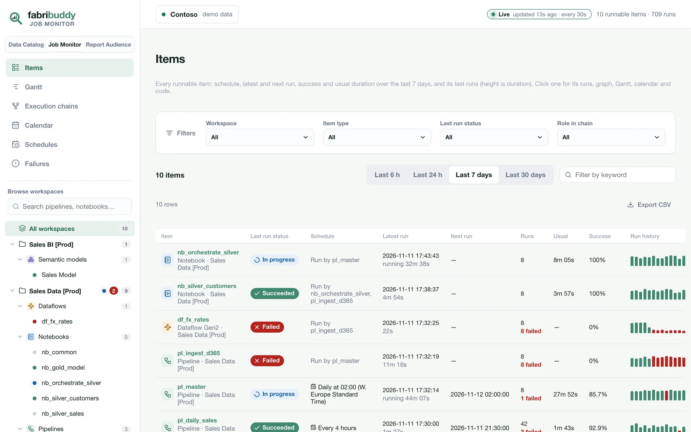
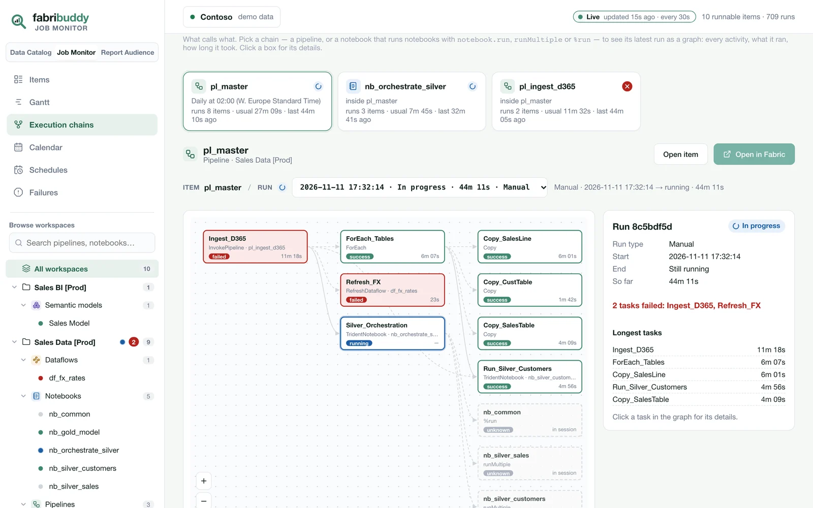
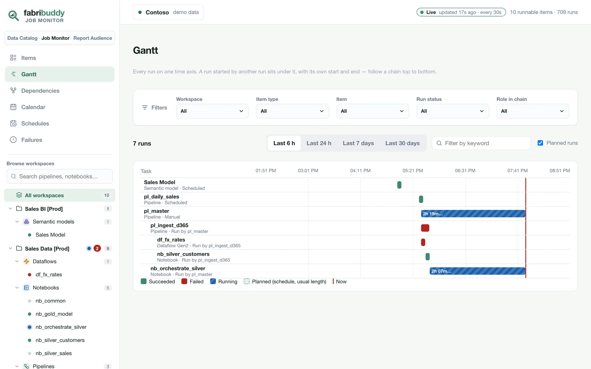
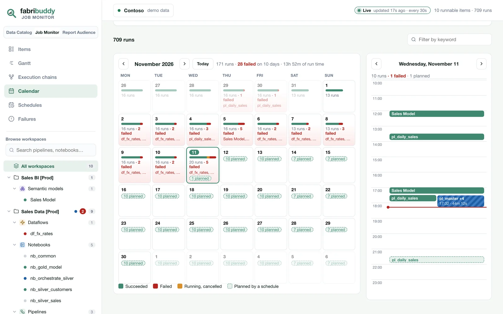
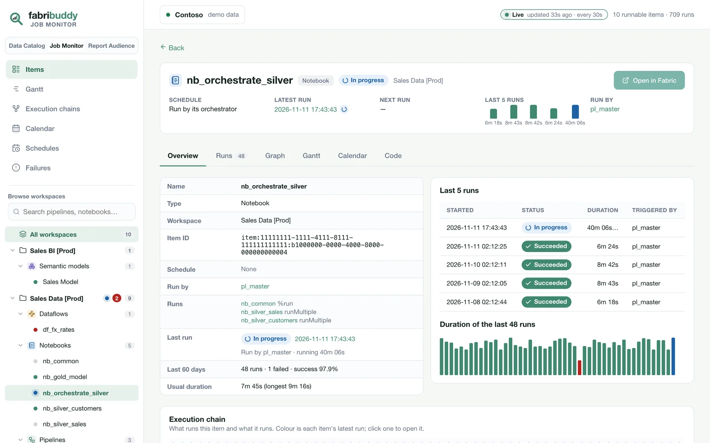
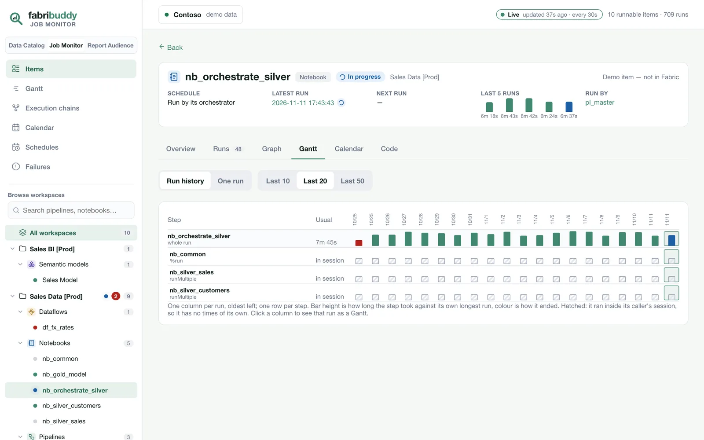

# Job Monitor

What runs in your tenant, what each run started, and how long every step took: pipelines,
notebooks, Dataflows Gen2, semantic model refreshes, Spark job definitions and copy jobs.

The Fabric Monitor hub lists runs one item at a time. The Job Monitor follows a run down its
chain. A run of `pl_master` opens to the child pipeline it invoked, that pipeline's dataflow and
notebooks, and the notebooks an orchestrator notebook ran with `runMultiple`, `notebook.run` or
`%run`. Each step shows how long it took against how long it usually takes.

<video class="fb-video" autoplay loop muted playsinline poster="../assets/video/monitor-demo-poster.webp">
  <source src="../assets/video/monitor-demo.mp4" type="video/mp4">
</video>

Every item and its last runs, then one pipeline: its details and its execution chain. Then every item's runs over the last 6 hours, and the month.

!!! info "Daily or live"
    By default the monitor is as fresh as the last daily scan. Turn on
    [live](#live) (`LIVE_MONITOR = True` when you deploy) and new runs show up within about a minute
    and a half: **FabriBuddy_Live** reads Fabric every 60 seconds, and the app checks for changes
    every 30 seconds.

{ .fb-shot }

## Pages

Every page except Execution chains has the same filters: workspace, item type, item, status, role in a chain and a keyword.
Items, Gantt and Failures also have a time range (last 6 hours, 24 hours, 7 days or 30 days), and
Schedules has the same choices looking ahead. Your picks follow you from page to page.

| Page | What it answers |
|---|---|
| **Items** | Every runnable item in one list: its schedule (or what runs it), the status and time of its latest run, its next run, its runs and failures in the range, its usual duration and success rate, and its run history as bars (height is duration, colour is status). |
| **Gantt** | Runs on a time axis. Over 6 or 24 hours each run is a row, and a run started by another sits under it. Over 7 or 30 days each item is one lane with all its runs on it, so drift and failed nights stand out. Planned runs show as outlines. |
| **Execution chains** | What calls what. Pick a chain (an orchestrator and everything it runs) and see its latest run as a graph: the pipelines, their activities, the notebooks and refreshes they start, each with its status and duration. Older runs are in the run picker. Click a box for its details. Below are the dependency checks for every chain, and a collapsible map of the whole estate drawn like the Data Catalog's lineage. This page has no filters: the chain you pick is the filter. |
| **Calendar** | A month of runs: each day's outcome, its failed items and what the schedules will start. Next to it, the picked day hour by hour, with each run (or chain) as a block. |
| **Schedules** | Every schedule, its next runs over the next 6 hours to 30 days, each item's last 5 runs, and items started twice. |
| **Failures** | Failed runs grouped by item and error, so ten nights of the same failure is one row marked *10×*. |

{ .fb-shot }

{ .fb-shot }

{ .fb-shot }

### An item

Open an item to see its schedule, latest run, next run, last five runs (duration and status) and
what runs it at the top, and **Open in Fabric** to go to the item in the Fabric portal. Below that are
its tabs:

- **Overview:** the item's details (type, workspace, ID, what starts it, its last error, the tables
  it reads and writes, its usual duration) and its last runs.
- **Runs:** every run, with how long it took against the usual time.
- **Graph:** one run's tasks, with details for each in a side panel.
- **Gantt:** the run history as one column per run and one row per step, so you can see which step
  got slower or started failing. Switch to **One run** for a single run's timeline.
- **Calendar:** the item's month (each day's runs and failures), a day hour by hour, and its busy
  hours: run time per weekday and hour, to see when it crowds the capacity.
- **Code.**

{ .fb-shot }

{ .fb-shot }

**Open in Fabric** is also on the picked chain and on a task's side panel in the run graph, for the
item that task ran. On the demo the button is greyed out, because the demo's items don't exist in
Fabric.

The sidebar lists workspaces and their items by type. Click a workspace to filter every page to it.
Click an item to open it. The dots show each item's latest run, and a pulse means it's running now.

## Dependency checks

The Execution chains page checks every data dependency, meaning an item that reads a table another
item writes:

- **Ran on failed input:** the reader ran after the writer's latest run failed, so it read stale
  or partial data.
- **Started before its input was ready:** the reader started while the writer was still running.
- **Not ordered:** no pipeline or orchestrator notebook runs the two in order. They start on their
  own schedules and only line up by luck.
- **Started twice:** an item has its own schedule and is also run by an orchestrator.

Each finding links to an example run and says how to fix it.

## How chains are found

- **Pipelines:** the activities Fabric reports for each run (`queryactivityruns`), with their own
  start, end, status and error. A child pipeline, notebook, dataflow or model refresh that an
  activity started is linked to its own run.
- **Notebooks:** `notebook.run`, `runMultiple` (including its DAG) and `%run`, parsed from the
  code, as on the [Data Catalog](data-catalog.md).

!!! note "Notebooks run inside another notebook have no times of their own"
    `runMultiple`, `notebook.run` and `%run` run the child inside the caller's Spark session. Fabric
    records one run for the caller and none for the child. These children show as **in session**
    across the caller's span, never with invented times.

## Live

By default the monitor shows what the last scan read, and the badge at the top says
**Last scan**.

To see runs as they happen, run **FabriBuddy_Live**. Every minute it reads what's running, what
those runs will start next, and anything a schedule is about to start, plus a rotating slice of
everything else. It then rewrites only the monitor's pages in `FabriBuddy_DB`. The app checks
every 30 seconds, so a new run or a finished step shows within about a minute and a half. The badge
then says **Live**. If the notebook stops, it says **Live paused**.

- **Turn it on:** run `Deploy_FabriBuddy` with `LIVE_MONITOR = True`. It schedules FabriBuddy_Live
  hourly, and each run stays live for 55 minutes. Or schedule the notebook yourself.
- **Turn it off:** turn off or delete the schedule in **FabriBuddy_Live → Schedule**.
- **Settings:** `minutes` (55) and `every_seconds` (60) in the notebook. Everything else comes
  from **Load_FabriBuddy_E2E**. Started before the first scan has finished, it waits for it.
  [All the details](settings.md#live-job-monitor).
- **Cost:** a small Python notebook session for as long as it runs, so all day when it's
  scheduled hourly. Without it, the monitor is as fresh as the last scan.
- **Read-only,** like the scan: the same service principal and GET-only calls (plus the read-only
  `queryactivityruns`). It never saves the scanner's state. The daily scan stays the only writer of
  that state, and it re-reads everything anyway.

## What's needed

Run history is read from workspaces where the service principal is a **Contributor** or higher.
That's the same access Fabric needs to list job instances. Schedules come from the Job Scheduler,
and a semantic model's refreshes and refresh schedule come from Power BI.
