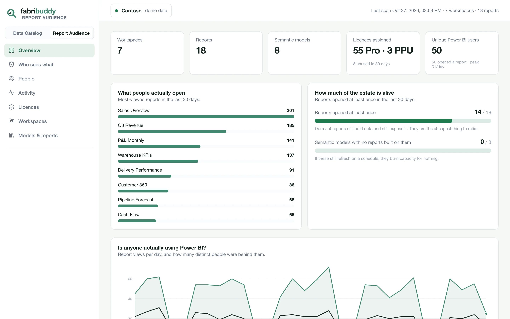
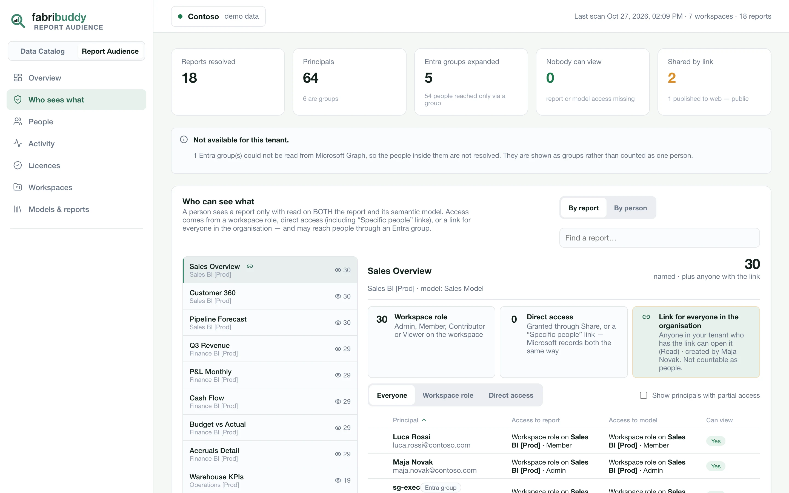
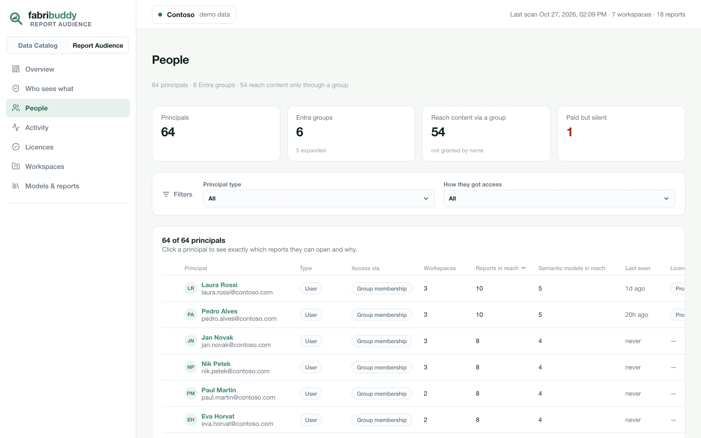
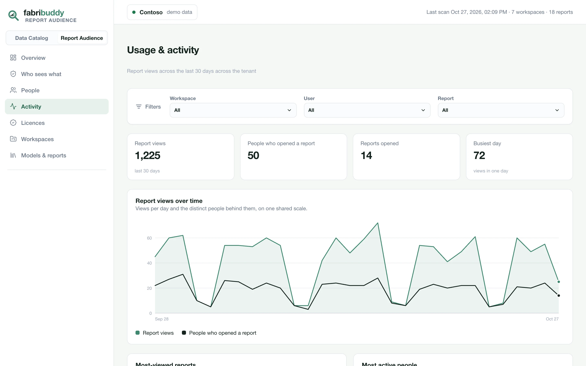
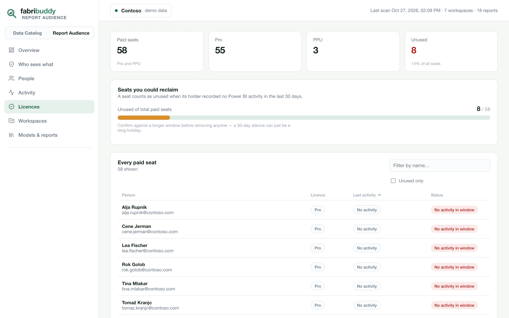

# Report Audience

Who can really see every Power BI report, who opens it, and which paid seats nobody uses.

## Overview

Workspaces, reports and semantic models scanned; licences assigned and how many went unused in 30
days; the reports people actually open; how much of the estate is in use; and daily views, with the
distinct people behind them.

{ .fb-shot }

## Who sees what

Pick a report to see everyone who can open it, and how: a workspace role, direct access, a link for
the whole organisation, or publish to web. Entra groups open up to the people inside them, nested
groups included. When a person has both a workspace role and direct access, the workspace role is
what counts.

{ .fb-shot }

## People

Every person and group with access: how they get it, how many workspaces, reports and semantic
models they can reach, when they last opened anything, and their licence. Open a person to see
everything they can see, and the path to each. Useful for access reviews, audits and leavers.

{ .fb-shot }

## Activity

Who opened what, and when, from the Power BI audit log, for the last 30 days (the log's own
retention). Filter by workspace, person or report. FabriBuddy keeps the log as it reads it, so each
scan fetches only the new days.

{ .fb-shot }

## Licences

Every Pro and Premium Per User seat, with the person's last activity. *Seats you could reclaim*
lists the ones with no activity in 30 days. A seat is never called unused when there's no activity
data to compare it with.

Licences need the optional [Microsoft Graph permissions](service-principal.md#2-microsoft-graph-permissions-optional).

{ .fb-shot }

## Workspaces and models

**Workspaces** lists each workspace's type (Fabric, Premium, PPU or Pro), its models, reports,
users, admins and last activity, and flags workspaces with a single admin. **Models & reports**
lists every semantic model with its owner, the reports built on it, and when they were last viewed.

## What it doesn't cover

- Row-level security roles and app audiences aren't evaluated.
- The audit log goes back about 30 days. Microsoft doesn't keep older activity.
