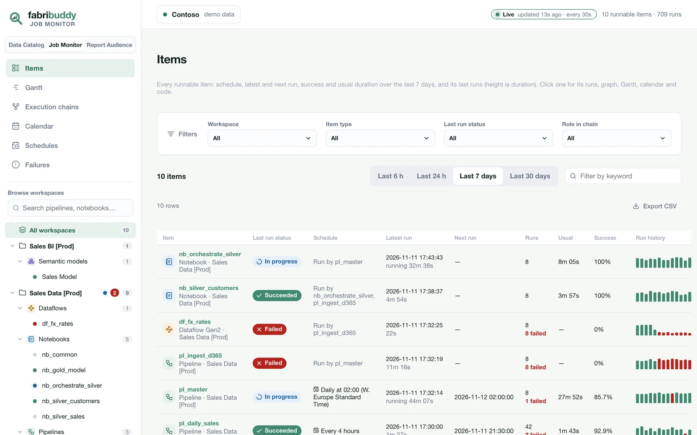
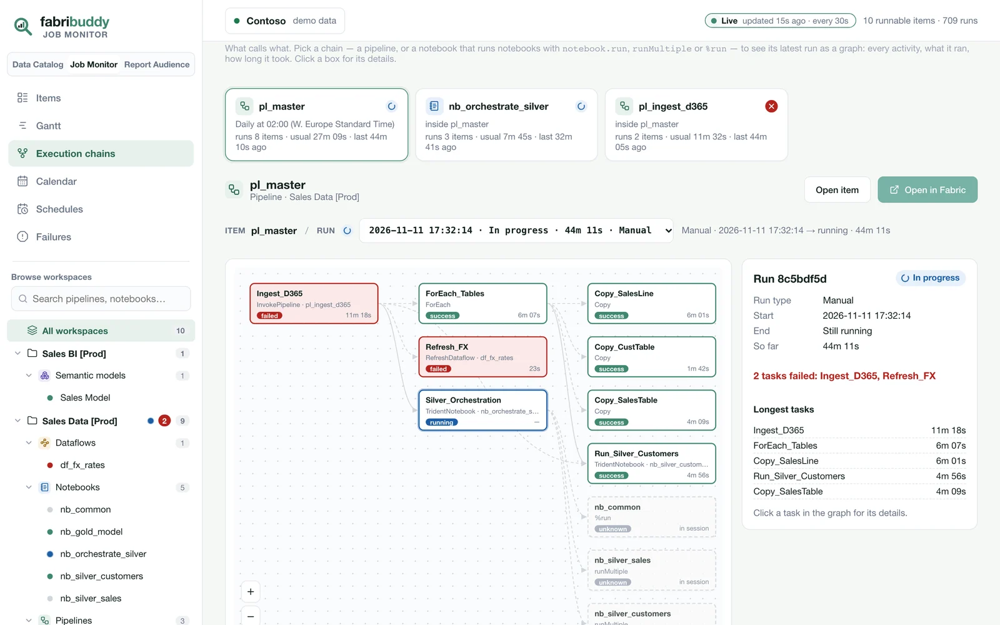
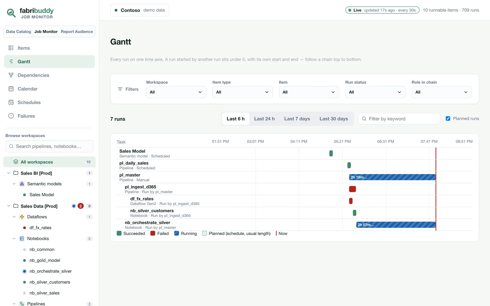
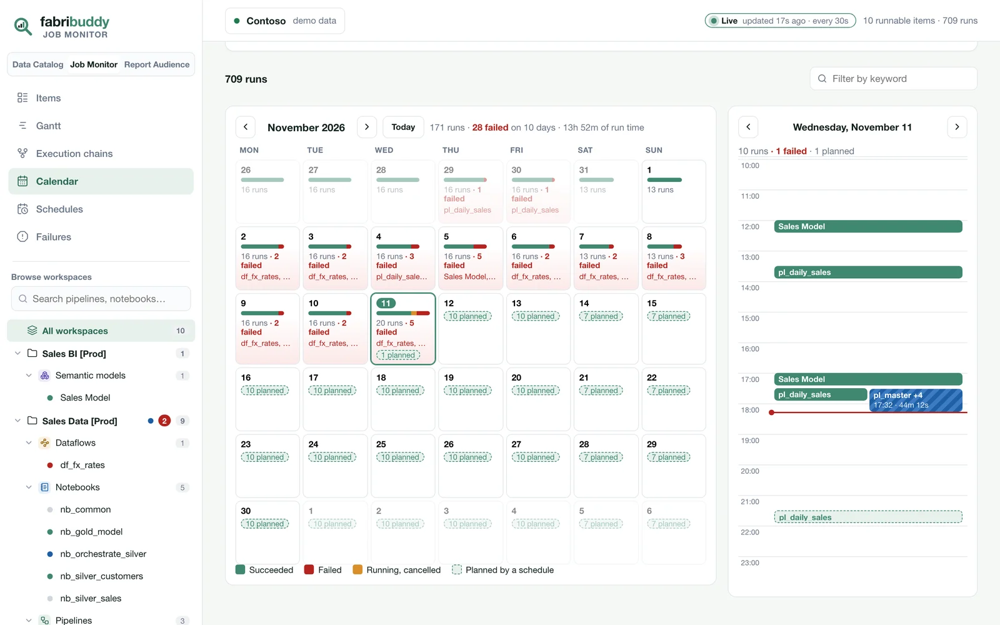
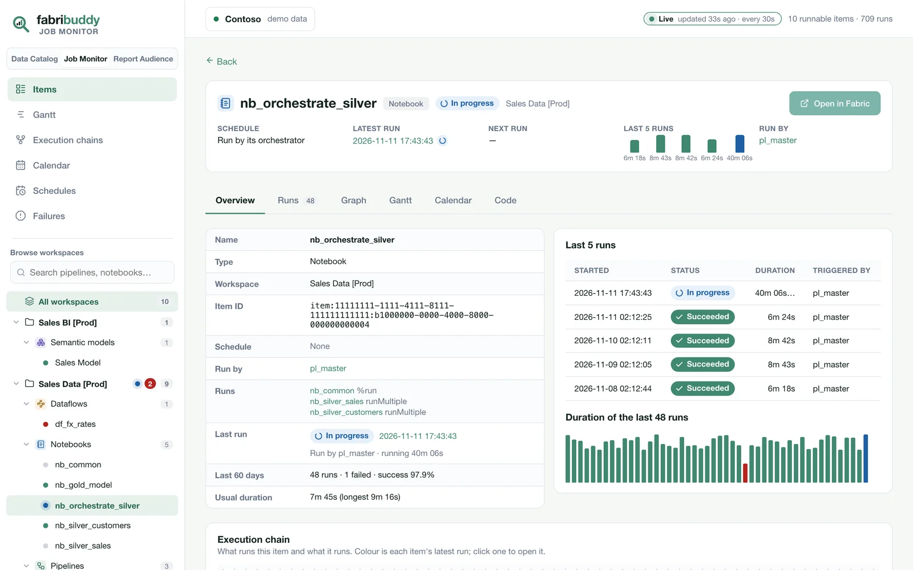
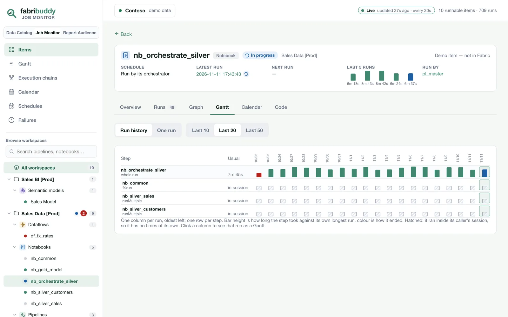

# What's new in 0.2: the Job Monitor

FabriBuddy started as a lineage tool: where every table in a Fabric tenant comes from, the exact
lines of code that write it, and who can see every Power BI report. Version 0.2 adds the question
that comes right after *"where does this table come from?"*, which is *"did the thing that writes it
actually run last night?"*

The **Job Monitor** shows every run of every pipeline, notebook, Dataflow Gen2, semantic model
refresh, Spark job definition and copy job in your tenant, in one app, next to the lineage.

[Try it in the live demo](https://zan-tavcar.github.io/msfabric-fabribuddy/demo/){ .md-button .md-button--primary }
[Download the deploy notebook](assets/Deploy_FabriBuddy.ipynb){ .md-button download="Deploy_FabriBuddy.ipynb" }

<video class="fb-video" autoplay loop muted playsinline poster="../assets/video/monitor-demo-poster.webp">
  <source src="../assets/video/monitor-demo.mp4" type="video/mp4">
</video>

Every item and its last runs, then one pipeline: its details, its run history step by step, its calendar and busy hours. Then the Gantt and the month.

## Why another monitor

The Fabric Monitor hub is fine for "did this one item fail?". It gets hard when the answer depends
on other items:

- A pipeline failed at 02:14, but **which activity**, and which notebook did that activity start?
- An orchestrator notebook ran ten notebooks with `runMultiple`. **Which one got slower?**
- A notebook succeeded, but **its input table's writer had failed** an hour earlier. Green, but
  wrong.
- Two items that depend on each other are on **separate schedules** and only line up by luck.

FabriBuddy already reads every pipeline definition and parses every notebook to build the lineage.
So it knows which item starts which, and which item writes which table. The Job Monitor puts the
run history on top of that.

## Items

{ .fb-shot }

Every runnable item in one list: its schedule, or what runs it; its latest and next run; its runs and
failures in the last 6 hours to 30 days; its usual duration and success rate; and its run history as
bars, where the height is the duration and the colour is the status. Filter by workspace, item type,
status, role in a chain or keyword, and the filters follow you to every page.

## Execution chains: what calls what

{ .fb-shot }

Pick a chain and see its latest run as a graph: the schedule that started it, the pipeline's
activities, the child pipelines they invoked, the dataflows, notebooks and model refreshes those
started, and the notebooks run inside a notebook with `runMultiple`, `notebook.run` or `%run`. Each
step has its own status and duration.

Below it are the **dependency checks**, across every chain:

- **Ran on failed input:** the reader ran after its input's writer failed.
- **Started before its input was ready:** the reader started while the writer was still running.
- **Not ordered:** nothing runs the two in order. They start on their own schedules.
- **Started twice:** an item has its own schedule and is also run by an orchestrator.

In the Contoso demo it finds that `nb_gold_model` ran ten times after `df_fx_rates` failed, and that
`Sales Model` is refreshed by its own schedule and by the pipeline.

## Gantt, Calendar, Schedules, Failures

{ .fb-shot }

- **Gantt:** over 6 or 24 hours each run is a row and a run started by another sits under it. Over
  7 or 30 days each item is one lane, so a nightly load creeping later stands out.
- **Calendar:** a month of runs with each day's outcome, its failed items and what the schedules will
  start, and the picked day hour by hour.
- **Schedules:** every schedule, its next runs and its last 5 runs.
- **Failures:** failed runs grouped by item and error, so ten nights of the same error is one row.

{ .fb-shot }

## One item

{ .fb-shot }

Open an item for its schedule, latest and next run, and last five runs at the top. Then the tabs:
an overview with the tables it reads and writes, the runs, a graph of one run, a **run history**
(one column per run, one row per step, to see which step got slower or started failing), a calendar
with the item's busy hours, and the code.

{ .fb-shot }

## Optional: live

By default the monitor is as fresh as the daily scan. Set `LIVE_MONITOR = True` when you deploy and
the **FabriBuddy_Live** notebook refreshes the monitor every minute, so a run that starts shows up in
the app within about a minute and a half. [More on live](job-monitor.md#live).

## Also in 0.2

- **0.2.1:** *Open in Fabric* on the item page, the picked chain and a task's side panel. Execution
  chains has no filter bar any more (pick a chain instead) and opens on the latest run.
- The products are now called **Data Catalog**, **Job Monitor** and **Report Audience**.
- Lineage follows schema-level shortcuts to their source tables, and `runMultiple` DAGs and
  `notebook.run` arguments into child notebooks (from 0.1.1).

## Same rules as before

- **It runs in your tenant.** The scanner, the database and the app all live in a workspace you own.
  There's no FabriBuddy server, account or telemetry. [How this works](data-stays-in-your-tenant.md).
- **Read-only.** It reads run history, schedules and metadata. It never starts, stops or changes a
  run, and it never reads the rows in your tables.
- **Free and MIT licensed.** [The code is on GitHub](https://github.com/zan-tavcar/msfabric-fabribuddy).

Already on FabriBuddy? [Update](update.md) by importing the new deploy notebook and running it.
New? [Deploy it](deploy.md) in about 15 minutes.
